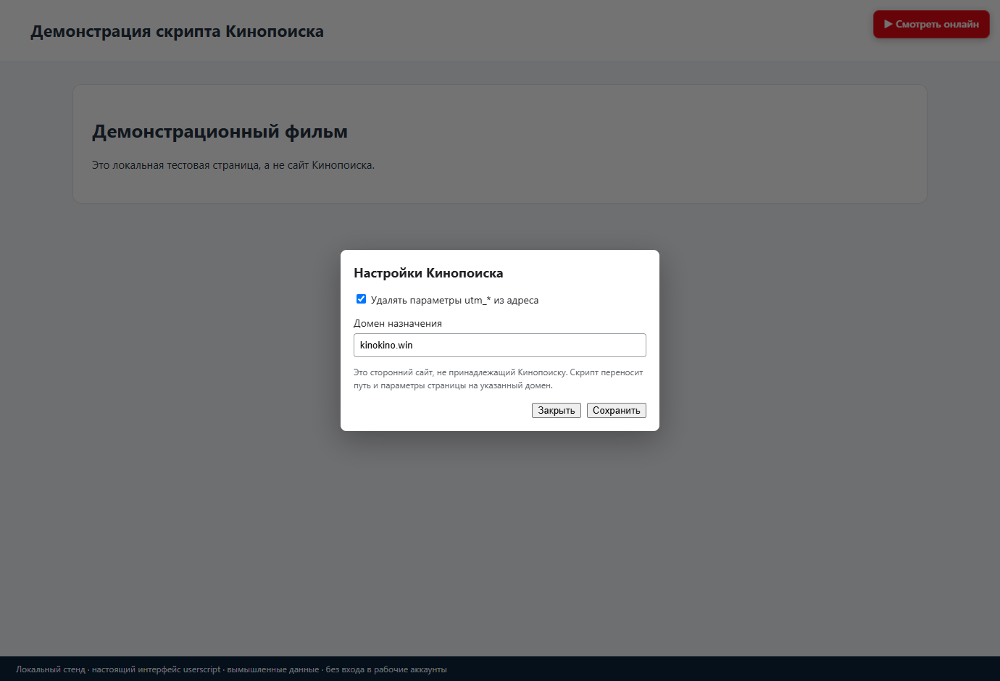

# Кинопоиск — чистые ссылки и быстрый переход

**Tampermonkey · 1.2.2 · Jeronimo701**

Небольшой userscript: убирает `utm_*` из адреса Кинопоиска и добавляет кнопку перехода на выбранный тобой сайт с тем же путём страницы.

[Установить скрипт](https://raw.githubusercontent.com/jeronimo701/Kinopoisk-clean-and-redirect/main/Kinopoisk_clean_and_redirect.user.js) · [Изменения](CHANGELOG.md) · [Сообщить о проблеме](https://github.com/jeronimo701/Kinopoisk-clean-and-redirect/issues)

*Настоящий интерфейс скрипта на локальной тестовой странице, с вымышленными данными. Это не снимок рабочего аккаунта или реального каталога сайта.*

## Что умеет

- Очистка UTM-параметров без перезагрузки страницы.
- Кнопка «Смотреть онлайн» с настраиваемым доменом назначения.
- Сохранение параметров в Tampermonkey.
- Скрытие `.topAdPad` на целевой странице фильма/сериала после перехода.

## Установка и первый запуск

1. Установи [Tampermonkey](https://www.tampermonkey.net/) в поддерживаемый браузер.
2. Нажми **«Установить скрипт»** выше и подтверди установку в расширении.
3. Открой Кинопоиск; в правом верхнем углу появится кнопка перехода.
4. В меню Tampermonkey выбери «Настройки Кинопоиска» и проверь домен назначения.
5. При необходимости выключи очистку UTM. Переход выполняется только по нажатию кнопки.

Не включай одновременно несколько старых копий этого скрипта.

## Обновления

Автообновление настроено: `@updateURL` ведёт на небольшой `.meta.js`, `@downloadURL` — на актуальный `.user.js` в этом публичном репозитории. GitHub-вход и токен не нужны.

**Если раньше стояла копия с `@updateURL none`, её нужно один раз переустановить по ссылке выше.** Такая копия сама не узнает новый адрес. `@name` и `@namespace` сохранены; перед переустановкой сделай резервную копию настроек средствами Tampermonkey. Дальше проверь, что автоматическая проверка обновлений включена в расширении; мгновенное уведомление не гарантируется.

[Как устроены updateURL и downloadURL](https://www.tampermonkey.net/documentation.php#meta:updateURL).

## Что важно знать

Домен назначения — сторонний сайт, не принадлежащий Кинопоиску. Скрипт только меняет адрес: не содержит плеер, не гарантирует доступность контента и не обходит авторизацию или оплату. По умолчанию указан `kinokino.win`; отправлять на него данные аккаунта не нужно.

### Почему запрашивается доступ ко всем сайтам

В заголовке есть `@match *://*/*`: он нужен для обработки выбранного домена после перехода. Вне Кинопоиска код проверяет путь фильма/сериала и кратковременную отметку перехода. Это широкое разрешение — проверь исходник перед установкой. Скрипт не читает пароль Кинопоиска.

## Проверка и разработка

На локальном стенде проверены очистка UTM, появление кнопки и окно настроек; внешние переходы отключены. Работа настоящего стороннего сайта и установленное расширение отдельно не проверены.

После изменения кода повысь `@version`, выполни `python tools/sync_meta.py` и `python -m unittest discover -s tests -v`, затем отправь `.user.js` и `.meta.js` вместе. Проверка синтаксиса: `node --check Kinopoisk_clean_and_redirect.user.js`.

## Условия использования

Самостоятельная доработка, не официальный продукт владельца сайта. Условия собственного кода: [LICENSE.txt](LICENSE.txt), область — [LICENSE-SCOPE.md](LICENSE-SCOPE.md). Разрешено бесплатное личное некоммерческое использование физическими лицами; использование организациями и продажа требуют отдельного разрешения. Это source-available, не MIT/GPL.

История переноса сохранена в Git и [историческом README](README-GIST-HISTORICAL.md); прежние ссылки Gist не являются установочными.
